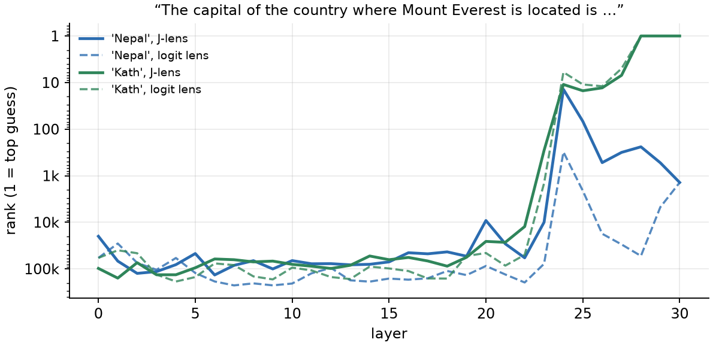

<h2>What is going on inside?</h2>

LLMs are text generators. We know they produce one token at a time. But do we know <em>how</em> they come up with
the answer?

Take the prompt: <strong>"The capital of the country where Mount Everest is located is …"</strong>. The answer is
Kathmandu. When I answer this, my head quietly does a few hops: Everest → Nepal → capital of Nepal → Kathmandu. I only
<em>say</em> "Kathmandu", but my brain also thought about Nepal, countries and capitals along the way.

Does an LLM do something similar? Does "Nepal" show up somewhere inside the model, even though it never says it?
Let's try to find out with a recent tool from Anthropic's interpretability research: the <strong>J-lens</strong>
(Jacobian lens). I use Qwen3.5-4B as the example model throughout, but the ideas apply to any transformer LLM.

<h2>How an LLM works, in three parts</h2>
<figure>
<svg viewBox="0 0 760 150" role="img" aria-label="LLM pipeline">
  <defs><marker id="a" viewBox="0 0 10 10" refX="9" refY="5" markerWidth="7" markerHeight="7" orient="auto"><path d="M0,0 L10,5 L0,10 z" class="jt-a"/></marker></defs>
  <g font-size="13" text-anchor="middle">
    <rect x="5" y="40" width="90" height="46" rx="6" class="jb-n"/><text x="50" y="60">text</text><text x="50" y="76" font-size="11" class="jt-m">"…Everest is"</text>
    <rect x="135" y="40" width="110" height="46" rx="6" class="jb-o"/><text x="190" y="60">1. Embedding</text><text x="190" y="76" font-size="11" class="jt-m">token → vector</text>
    <rect x="285" y="30" width="200" height="66" rx="6" class="jb-b"/><text x="385" y="55">2. Transformer blocks</text><text x="385" y="73" font-size="11" class="jt-m">block 1 → block 2 → … → block 32</text><text x="385" y="88" font-size="11" class="jt-m">(attention + MLP each)</text>
    <rect x="525" y="40" width="110" height="46" rx="6" class="jb-g"/><text x="580" y="60">3. LM head</text><text x="580" y="76" font-size="11" class="jt-m">vector → scores</text>
    <rect x="675" y="40" width="80" height="46" rx="6" class="jb-n"/><text x="715" y="60">next token</text><text x="715" y="76" font-size="11" class="jt-m">" Kath"</text>
    <g class="ja" stroke-width="1.5" marker-end="url(#a)"><line x1="95" y1="63" x2="133" y2="63"/><line x1="245" y1="63" x2="283" y2="63"/><line x1="485" y1="63" x2="523" y2="63"/><line x1="635" y1="63" x2="673" y2="63"/></g>
    <g font-size="11" class="jt-b" font-family="Menlo, monospace"><text x="114" y="120">[seq]</text><text x="264" y="120">[seq, 2560]</text><text x="504" y="120">[seq, 2560]</text><text x="654" y="120">[seq, 248320]</text></g>
    <text x="380" y="144" font-size="11" class="jt-m">shapes on the arrows: seq = number of tokens, 2560 = hidden size, 248,320 = vocabulary size</text>
  </g>
</svg>
<figcaption>The three parts of an LLM, with the tensor shapes for Qwen3.5-4B.</figcaption>
</figure>
<ol>
<li><strong>Embedding.</strong> Each token id is swapped for a vector of 2560 numbers (a row of a big lookup table).</li>
<li><strong>Transformer blocks.</strong> 32 blocks, one after another. Input and output have the same shape,
<code>[seq, 2560]</code>. Each block has <em>attention</em> (tokens look at earlier tokens and mix information) and an
<em>MLP</em> (each token's vector is processed on its own). After every block, each token's vector knows a bit more
about its context. "Everest" starts as just the word, and a few blocks later it carries "a mountain, in Nepal, the
tallest".</li>
<li><strong>LM head.</strong> First an <strong>RMSNorm</strong>: it rescales the vector to a standard size, so only its
direction matters (plus a learned weight per number). Then one big matrix gives a score to every token in the
vocabulary, <code>[2560] → [248320]</code>. Softmax turns the scores into probabilities. From here on, "LM head" means
norm + this matrix.</li>
</ol>
<table>
<tr><th>Part (Qwen3.5-4B)</th><th>Input → output</th><th>Trainable parameters</th></tr>
<tr><td>Embedding</td><td>token ids <code>[seq]</code> → <code>[seq, 2560]</code></td><td>~636M (248,320 × 2560)</td></tr>
<tr><td>One block</td><td><code>[seq, 2560]</code> → <code>[seq, 2560]</code></td><td>~110M (attention ~40M, MLP ~71M)</td></tr>
<tr><td>All 32 blocks</td><td></td><td>~3.6B</td></tr>
<tr><td>LM head</td><td><code>[seq, 2560]</code> → <code>[seq, 248320]</code></td><td>shares the embedding matrix in Qwen ("tied")</td></tr>
<tr><td>Total</td><td></td><td>~4.2B</td></tr>
</table>

<h3>The residual stream: one shared whiteboard</h3>

A key detail: a block does not <em>replace</em> the vector. It reads it, computes something, and <strong>adds</strong>
its result back:

<pre><code class="nohighlight">x_after_block_5 = x_after_block_4 + what_block_5_computed</code></pre>

So each token has one running vector (the <strong>residual stream</strong>) and every block writes notes onto it, like
a shared whiteboard. The final vector is the embedding plus everything all 32 blocks added.

<figure>
<svg viewBox="0 0 760 140" role="img" aria-label="Residual stream">
  <defs><marker id="b" viewBox="0 0 10 10" refX="9" refY="5" markerWidth="7" markerHeight="7" orient="auto"><path d="M0,0 L10,5 L0,10 z" class="jt-a"/></marker></defs>
  <g font-size="13" text-anchor="middle">
    <line x1="20" y1="100" x2="735" y2="100" class="js-b" stroke-width="4" marker-end="url(#b)"/>
    <text x="60" y="128" font-size="12" class="jt-b">embedding</text><text x="690" y="128" font-size="12" class="jt-b">to LM head</text>
    <g>
      <rect x="130" y="20" width="110" height="36" rx="6" class="jb-b"/><text x="185" y="43">block 1</text>
      <rect x="320" y="20" width="110" height="36" rx="6" class="jb-b"/><text x="375" y="43">block 2</text>
      <text x="470" y="43">…</text>
      <rect x="510" y="20" width="110" height="36" rx="6" class="jb-b"/><text x="565" y="43">block 32</text>
    </g>
    <g class="ja" fill="none" stroke-width="1.3" marker-end="url(#b)">
      <path d="M140 100 C140 80 150 70 150 58"/><path d="M220 58 C220 75 240 88 252 96"/>
      <path d="M330 100 C330 80 340 70 340 58"/><path d="M410 58 C410 75 430 88 442 96"/>
      <path d="M520 100 C520 80 530 70 530 58"/><path d="M600 58 C600 75 620 88 632 96"/>
    </g>
    <g class="jb-w"><circle cx="258" cy="100" r="9"/><circle cx="448" cy="100" r="9"/><circle cx="638" cy="100" r="9"/></g>
    <g font-size="14" font-weight="bold"><text x="258" y="105">+</text><text x="448" y="105">+</text><text x="638" y="105">+</text></g>
    <text x="150" y="80" font-size="11" class="jt-m">read</text><text x="250" y="76" font-size="11" class="jt-m">add</text>
  </g>
</svg>
<figcaption>Every block reads the stream and adds its result. Nothing is overwritten.</figcaption>
</figure>

<strong>Thinking in directions.</strong> A concept like "Nepal" is not stored in one of the 2560 numbers. It is a
<em>direction</em>: a pattern across all of them. A hidden vector is roughly a mix of concepts, each with some strength:

<pre><code class="nohighlight">h ≈ 3 × (Nepal direction) + 2 × (mountain direction) + 1 × (capital direction) + …</code></pre>

The LM head has one direction per word. A word's score is the dot product of h with that word's direction: "how much
does h point towards this word?"

<h2>The logit lens: read a middle layer with the LM head</h2>

Here's a simple idea. The LM head was trained to read the vector after the <em>last</em> block. What if we hand it the
vector after block 12 instead? The shapes fit (<code>[2560]</code> in either case), so we get a list of top words for
every layer. This is called the <strong>logit lens</strong>.

<figure>
<svg viewBox="0 0 760 170" role="img" aria-label="Logit lens">
  <defs><marker id="c" viewBox="0 0 10 10" refX="9" refY="5" markerWidth="7" markerHeight="7" orient="auto"><path d="M0,0 L10,5 L0,10 z" class="jt-a"/></marker></defs>
  <g font-size="12" text-anchor="middle">
    <line x1="20" y1="40" x2="735" y2="40" class="js-b" stroke-width="4" marker-end="url(#c)"/>
    <text x="20" y="25" class="jt-b" text-anchor="start">residual stream →</text>
    <g class="jt-b"><circle cx="160" cy="40" r="5"/><circle cx="330" cy="40" r="5"/><circle cx="500" cy="40" r="5"/><circle cx="670" cy="40" r="5"/></g>
    <text x="160" y="25">after block 12</text><text x="330" y="25">after block 16</text><text x="500" y="25">after block 24</text><text x="670" y="25">after block 32</text>
    <g class="ja" stroke-width="1.3" marker-end="url(#c)"><line x1="160" y1="46" x2="160" y2="78"/><line x1="330" y1="46" x2="330" y2="78"/><line x1="500" y1="46" x2="500" y2="78"/><line x1="670" y1="46" x2="670" y2="78"/></g>
    <g class="jb-g"><rect x="115" y="80" width="90" height="30" rx="5"/><rect x="285" y="80" width="90" height="30" rx="5"/><rect x="455" y="80" width="90" height="30" rx="5"/><rect x="625" y="80" width="90" height="30" rx="5"/></g>
    <text x="160" y="100">LM head</text><text x="330" y="100">LM head</text><text x="500" y="100">LM head</text><text x="670" y="100">LM head</text>
    <g font-size="11" class="jt-m"><text x="160" y="132">"souhaitent", "ulte"</text><text x="330" y="132">"titulaire", "saura"</text><text x="500" y="132">"叫什么", "首府"</text><text x="670" y="132">" Kath"</text></g>
    <text x="380" y="160" font-size="11" class="jt-m">the same LM head, plugged in after different blocks (real top words from Qwen3.5-4B)</text>
  </g>
</svg>
<figcaption>The logit lens: one LM head, attached to any layer.</figcaption>
</figure>

For the Everest prompt, the logit lens gives junk in the middle: random word pieces in many languages. Around
block 24 it starts to make sense (首府 is Chinese for "capital"), and by the end it says " Kath" (Kathmandu is split into
<code>" Kath" "mand" "u"</code>). "Nepal" never gets close to the top: its best rank is 310.

<h2>What's wrong with the logit lens?</h2>

The LM head was only ever trained on the last layer's vectors. A middle layer writes things in its own "format":
information that later blocks will still move around, rotate and rescale before it reaches the LM head. One way to
picture it: layer L and layer T (near the end) use different <strong>coordinate systems</strong>, and the LM head only
understands the one of layer T.

How true is that picture? Partly. Thanks to the residual stream, all layers write into the <em>same</em> vector, so the
coordinate systems are not totally different. That's why the logit lens works at all near the end. But they are not
the same either: when we measured the translation matrix below for a real model, it was far from the identity matrix
("do nothing"). So the idea is a useful assumption, and the honest way to check it is by experiment (later in this post).

If we accept it, the fix is obvious: <strong>first translate layer L into layer T's coordinate system, then use the
LM head.</strong> The J-lens says this translation can be approximated by one matrix per layer, Jl.

<figure>
<svg viewBox="0 0 760 120" role="img" aria-label="Logit lens vs J-lens">
  <defs><marker id="d" viewBox="0 0 10 10" refX="9" refY="5" markerWidth="7" markerHeight="7" orient="auto"><path d="M0,0 L10,5 L0,10 z" class="jt-a"/></marker></defs>
  <g font-size="13" text-anchor="middle">
    <text x="5" y="35" text-anchor="start" font-weight="bold" font-size="12">logit lens</text>
    <text x="5" y="92" text-anchor="start" font-weight="bold" font-size="12">J-lens</text>
    <rect x="90" y="15" width="90" height="32" rx="5" class="jb-b"/><text x="135" y="36">h (layer L)</text>
    <rect x="450" y="15" width="100" height="32" rx="5" class="jb-g"/><text x="500" y="36">LM head</text>
    <rect x="620" y="15" width="110" height="32" rx="5" class="jb-n"/><text x="675" y="36">top words</text>
    <rect x="90" y="72" width="90" height="32" rx="5" class="jb-b"/><text x="135" y="93">h (layer L)</text>
    <rect x="250" y="66" width="130" height="44" rx="5" class="jb-o"/><text x="315" y="86">J<tspan font-size="10" dy="3">l</tspan><tspan dy="-3"> (translate)</tspan></text><text x="315" y="102" font-size="10" class="jt-m">[2560 × 2560]</text>
    <rect x="450" y="72" width="100" height="32" rx="5" class="jb-g"/><text x="500" y="93">LM head</text>
    <rect x="620" y="72" width="110" height="32" rx="5" class="jb-n"/><text x="675" y="93">top words</text>
    <g class="ja" stroke-width="1.4" marker-end="url(#d)"><line x1="180" y1="31" x2="448" y2="31"/><line x1="550" y1="31" x2="618" y2="31"/><line x1="180" y1="88" x2="248" y2="88"/><line x1="380" y1="88" x2="448" y2="88"/><line x1="550" y1="88" x2="618" y2="88"/></g>
  </g>
</svg>
<figcaption>The only difference: one matrix Jl per layer, applied before the LM head.</figcaption>
</figure>

If this works, we can attach the LM head to any layer and see which words the model is "holding" there, including
words it never outputs, like "Nepal".

<h2>What is Jl?</h2>

Jl is a <strong>Jacobian</strong>: the table of slopes of "everything between layer L and layer T". It
answers: <em>if I nudge the vector at layer L a little, how does layer T change?</em> In other words, it describes how
the model carries things from layer L to layer T. That's the translation we want.

<h2>Computing J, with a toy you can check by hand</h2>

<h3>First, autograd</h3>

PyTorch can tell us how any value depends on earlier values. It records every calculation, then walks backwards and
gives the gradient (the slope) of the result with respect to each input. A tiny example:

<pre><code class="language-python">a = torch.tensor(2., requires_grad=True)
b = torch.tensor(5., requires_grad=True)
y = a * b + 3 * a                      # y = 16
torch.autograd.grad(y, [a, b])         # → (8., 2.)</code></pre>

Nudge <code>a</code> by a little and y moves 8 times as much (b + 3 = 8). Nudge <code>b</code> and y moves 2 times as
much (a = 2). The same works inside an LLM: pick any number at layer T and ask autograd how it depends on every number at
layer L. That's all we need.

<h3>The toy</h3>

<strong>3 tokens</strong> (positions 0, 1, 2), and every hidden vector has <strong>2 numbers</strong> (instead of 2560).
So layer L is a <code>[3, 2]</code> table, and layer T is also <code>[3, 2]</code>.

We don't need to know what the blocks between L and T do inside. That's autograd's job: it measures how layer T
depends on layer L, whatever the blocks are. For this post I used a tiny made-up model so the numbers stay small and
easy to add. Like a real LLM, a token in it only looks at itself and earlier tokens, never later ones.

<h3>The grid: one 2×2 matrix for every pair of positions</h3>

For every source position p (at layer L) and target position p' (at layer T) there is a 2×2 matrix. It says how the
two output numbers of token p' depend on the two input numbers of token p:

block[p → p'] =
<table class="m"><tr><td>∂x_T[p'][0] / ∂x_L[p][0]</td><td>∂x_T[p'][0] / ∂x_L[p][1]</td></tr>
<tr><td>∂x_T[p'][1] / ∂x_L[p][0]</td><td>∂x_T[p'][1] / ∂x_L[p][1]</td></tr></table>

Rows are the output numbers (0 and 1), columns are the input numbers (0 and 1). Here is the full grid for our toy:

<table class="blocks">
<tr><th></th><th>target p' = 0</th><th>target p' = 1</th><th>target p' = 2</th></tr>
<tr><th>source p = 0</th>
 <td><table class="m"><tr><td>2</td><td>0</td></tr><tr><td>1</td><td>1</td></tr></table></td>
 <td><table class="m"><tr><td>0</td><td>1</td></tr><tr><td>1</td><td>0</td></tr></table></td>
 <td><table class="m"><tr><td>0</td><td>0.5</td></tr><tr><td>0.5</td><td>0</td></tr></table></td></tr>
<tr><th>source p = 1</th>
 <td class="z"><table class="m"><tr><td>0</td><td>0</td></tr><tr><td>0</td><td>0</td></tr></table></td>
 <td><table class="m"><tr><td>2</td><td>0</td></tr><tr><td>1</td><td>1</td></tr></table></td>
 <td><table class="m"><tr><td>0</td><td>0.5</td></tr><tr><td>0.5</td><td>0</td></tr></table></td></tr>
<tr><th>source p = 2</th>
 <td class="z"><table class="m"><tr><td>0</td><td>0</td></tr><tr><td>0</td><td>0</td></tr></table></td>
 <td class="z"><table class="m"><tr><td>0</td><td>0</td></tr><tr><td>0</td><td>0</td></tr></table></td>
 <td><table class="m"><tr><td>2</td><td>0</td></tr><tr><td>1</td><td>1</td></tr></table></td></tr>
</table>

<ul>
<li><strong>Diagonal</strong> (p' = p): a token's effect on itself.</li>
<li><strong>Above the diagonal</strong> (p' &gt; p): a token's effect on later tokens, which read it through attention.</li>
<li><strong>Below the diagonal</strong>: all zero. Changing token 2 can't change token 0, because token 0 never looks
ahead.</li>
</ul>

<h3>Filling the grid with autograd</h3>

Take one output number, say <code>x_T[1][0]</code> (token 1, number 0), and ask autograd for its gradient with respect
to the whole layer-L table. The answer has the same shape as layer L, <code>[3, 2]</code>:

<pre><code class="nohighlight">torch.autograd.grad(x_T[1][0], x_L)    # → [[0, 1],    from token 0
                                        #    [2, 0],    from token 1
                                        #    [0, 0]]    from token 2</code></pre>

Each line is <strong>row 0</strong> of one block in the column p' = 1: <code>[0, 1]</code> is row 0 of block[0 → 1],
<code>[2, 0]</code> is row 0 of block[1 → 1], and <code>[0, 0]</code> is row 0 of block[2 → 1]. Asking
again for <code>x_T[1][1]</code> gives row 1 of the same blocks. So one backward pass per output number fills the
grid, one row at a time.

<h3>From the grid to J: across token positions</h3>

<strong>Add along each row</strong> (over all targets p'). Something written at token 0 gets used by every later
token, so we count its total effect:

S0 = <table class="m"><tr><td>2</td><td>0</td></tr><tr><td>1</td><td>1</td></tr></table> +
<table class="m"><tr><td>0</td><td>1</td></tr><tr><td>1</td><td>0</td></tr></table> +
<table class="m"><tr><td>0</td><td>0.5</td></tr><tr><td>0.5</td><td>0</td></tr></table> =
<table class="m"><tr><td>2</td><td>1.5</td></tr><tr><td>2.5</td><td>1</td></tr></table>

S1 = block[1→1] + block[1→2] =
<table class="m"><tr><td>2</td><td>0</td></tr><tr><td>1</td><td>1</td></tr></table> +
<table class="m"><tr><td>0</td><td>0.5</td></tr><tr><td>0.5</td><td>0</td></tr></table> = <table class="m"><tr><td>2</td><td>0.5</td></tr><tr><td>1.5</td><td>1</td></tr></table>

S2 = block[2→2] = <table class="m"><tr><td>2</td><td>0</td></tr><tr><td>1</td><td>1</td></tr></table>

<strong>Then average over the source positions p</strong>, because we want one matrix that works at any position:

J(text 1) = (S0 + S1 + S2) / 3 =
<table class="m"><tr><td>2</td><td>0.667</td></tr><tr><td>1.667</td><td>1</td></tr></table>

<strong>A shortcut used in practice:</strong> instead of one output number at a time, ask autograd for
the gradient of <em>number 0 added over all tokens</em> (<code>x_T[0][0] + x_T[1][0] + x_T[2][0]</code>). That gives row 0 of
S0, S1 and S2 in one pass: <code>[[2, 1.5], [2, 0.5], [2, 0]]</code>. So the cost is one
backward pass per hidden number (2560 for the 4B model) instead of one per (token, number) pair.

<strong>A detail:</strong> the real lens skips the first 4 positions and the last one, as sources and as
targets. The first tokens are "attention sinks" (where attention parks when it has nothing better to look at), so their
vectors are huge and unusual. The last position has no next token in the text. Out of 128 tokens, 123 are used.

<h3>Across different texts</h3>

A different text has different words, so attention looks at different places, and autograd gives a grid with
different numbers above the diagonal. Same steps for text 2:

S0 = <table class="m"><tr><td>2</td><td>0.6</td></tr><tr><td>1.6</td><td>1</td></tr></table>
&nbsp; S1 = <table class="m"><tr><td>2</td><td>0.8</td></tr><tr><td>1.8</td><td>1</td></tr></table>
&nbsp; S2 = <table class="m"><tr><td>2</td><td>0</td></tr><tr><td>1</td><td>1</td></tr></table>

J(text 2) = (S0 + S1 + S2) / 3 =
<table class="m"><tr><td>2</td><td>0.467</td></tr><tr><td>1.467</td><td>1</td></tr></table>

J-lens = (J(text 1) + J(text 2)) / 2 =
<table class="m"><tr><td>2</td><td>0.567</td></tr><tr><td>1.567</td><td>1</td></tr></table>

Some numbers are the same in every text (the 2 and the 1 on the diagonal), so they stay. Others depend on the text
(0.667 in text 1, 0.467 in text 2), so they get averaged. With real text, averaging keeps "how the model moves information in
general" and smooths out the details of any one text.

<figure>
<svg viewBox="0 0 760 110" role="img" aria-label="Average over texts">
  <defs><marker id="e" viewBox="0 0 10 10" refX="9" refY="5" markerWidth="7" markerHeight="7" orient="auto"><path d="M0,0 L10,5 L0,10 z" class="jt-a"/></marker></defs>
  <g font-size="12" text-anchor="middle">
    <g class="jb-o"><rect x="20" y="30" width="60" height="50"/><rect x="120" y="30" width="60" height="50"/><rect x="220" y="30" width="60" height="50"/><rect x="340" y="30" width="60" height="50"/></g>
    <text x="50" y="60">J(text 1)</text><text x="150" y="60">J(text 2)</text><text x="250" y="60">J(text 3)</text><text x="310" y="60">…</text><text x="370" y="60">J(text N)</text>
    <text x="50" y="98" class="jt-m" font-size="11">a recipe</text><text x="150" y="98" class="jt-m" font-size="11">some code</text><text x="250" y="98" class="jt-m" font-size="11">a news story</text>
    <line x1="410" y1="55" x2="520" y2="55" class="ja" stroke-width="1.5" marker-end="url(#e)"/><text x="465" y="45">average</text>
    <rect x="530" y="22" width="80" height="66" class="jb-o2"/><text x="570" y="52">J-lens</text><text x="570" y="68" font-size="11">for layer L</text>
    <text x="690" y="50" font-size="11" class="jt-m">one per layer,</text><text x="690" y="64" font-size="11" class="jt-m">no labels needed</text>
  </g>
</svg>
<figcaption>The lens for each layer is the average over plain, unlabeled text.</figcaption>
</figure>

In one line, the formula you'll see in papers is just these steps:

<pre><code class="nohighlight">J_l = mean over texts ( mean over positions p ( sum over p' ≥ p of  block[p → p'] ) )</code></pre>

<h2>So what does Jl · h give us?</h2>

Remember, Jl describes how changes in each hidden-state dimension at layer L influence the hidden-state
dimensions at layer T. When we calculate Jl · h, we combine those influences using the values in h. The result
is a new vector describing <strong>how the layer-T representation would respond to a small change in the direction of
h</strong>.

This vector is expressed in layer-T dimensions, so we can apply the LM head to it (WU Jl h) to
see which token scores that direction tends to increase. For example, if h contains a cat-related direction that tends
to strengthen the final representation associated with "cat", the J-lens may give "cat" a high score.

Crucially, Jl · h is <strong>not</strong> the actual layer-T hidden state. It is a sensitivity-based picture
of the information in h. And in practice, Jl is not the Jacobian of one text: it is the average over many
texts that we computed above.

<h2>Back to Nepal</h2>

Now we use it: for every layer, translate with Jl, then apply the LM head. I downloaded a pre-fitted J-lens
for Qwen3.5-4B (more on that below) and ran it on prompts where the model has to think of a country without saying
it. Everything is read at the last token of the prompt, where the model is about to answer.

Here's the rank of "Nepal" and " Kath" at every layer for our Everest prompt (rank 1 = the lens's top guess):

<figure>

<figcaption>Solid = J-lens, dashed = logit lens. The top of the chart is rank 1.</figcaption>
</figure>

<h3>Layer by layer</h3>

Top words alone can be misleading, so each table shows the top 3 words of each lens <em>and</em> the rank of the
words we care about (out of 248,320 tokens).

<strong>1. "The capital of the country where Mount Everest is located is"</strong>, and the model says " Kath".

<table class="lt">
<tr><th>layer</th><th>J-lens top 3</th><th>logit lens top 3</th><th>rank of "Nepal" J-lens / logit</th><th>rank of "Kath" J-lens / logit</th></tr>
<tr><td>8</td><td><code> capital</code>, <code> cities</code>, <code> capitals</code></td><td><code> cherchez</code>, <code>ADDRESS</code>, <code>REFERENCE</code></td><td class="n">66,743 / 204,969</td><td class="n">70,886 / 145,221</td></tr>
<tr><td>12</td><td><code>country</code>, <code> metropolitan</code>, <code> столиц</code> (capital)</td><td><code> souhaitent</code>, <code>ulte</code>, <code> nemlig</code></td><td class="n">77,334 / 95,388</td><td class="n">98,261 / 149,920</td></tr>
<tr><td>16</td><td><code>&lt;|im_end|&gt;</code>, <code>的名称</code> (the name of), <code>____</code></td><td><code> titulaire</code>, <code>{}&quot;.</code>, <code> saura</code></td><td class="n">45,111 / 170,725</td><td class="n">56,900 / 111,474</td></tr>
<tr><td>20</td><td><code> called</code>, <code>located</code>, <code> называется</code> (is called)</td><td><code> capitale</code>, <code>ؤل</code>, <code>........</code></td><td class="n">9,169 / 86,664</td><td class="n">25,749 / 45,704</td></tr>
<tr><td>24</td><td><code> capital</code>, <code> called</code>, <code> India</code></td><td><code>叫什么</code> (what is it called), <code>首府</code> (capital), <code> Capitals</code></td><td class="n">14 / 310</td><td class="n">11 / 6</td></tr>
<tr><td>26</td><td><code> capital</code>, <code>capital</code>, <code>Capital</code></td><td><code>capital</code>, <code> capitals</code>, <code> capitale</code></td><td class="n">524 / 17,645</td><td class="n">13 / 12</td></tr>
<tr><td>28</td><td><code> Kath</code>, <code> capital</code>, <code>capital</code></td><td><code> Kath</code>, <code>ปัก</code>, <code> kath</code></td><td class="n">240 / 52,767</td><td class="n">1 / 1</td></tr>
<tr><td>30</td><td><code> Kath</code>, <code> kath</code>, <code> called</code></td><td><code> Kath</code>, <code> kath</code>, <code> called</code></td><td class="n">1,399 / 1,399</td><td class="n">1 / 1</td></tr>
</table>

<ul>
<li>Layers 8–12: the logit lens shows junk. The J-lens already shows <em>what kind of thing</em> the model is looking for:
"capital", "country".</li>
<li>Layers 16–20: blanks and "called". The prompt reads like a fill-in-the-blank quiz, and the model treats it like one.</li>
<li>Layer 24: "Nepal" jumps to rank 14 with the J-lens, versus 310 with the logit lens. The J-lens top words there are
"capital", "called", "India", so the model seems to briefly consider India too.</li>
<li>Layer 28 onwards: " Kath" is on top in both lenses. The answer is ready.</li>
</ul>

<strong>2. "The currency of the country where the Eiffel Tower is located is the"</strong>, and the model says
" Euro". A different question and a different hidden country, to check this isn't just a Nepal thing.

<table class="lt">
<tr><th>layer</th><th>J-lens top 3</th><th>logit lens top 3</th><th>rank of "France" J-lens / logit</th><th>rank of "euro" J-lens / logit</th></tr>
<tr><td>8</td><td><code> currency</code>, <code> money</code>, <code>币</code> (currency)</td><td><code> democr</code>, <code>дроб</code>, <code>当地</code> (local)</td><td class="n">13,634 / 105,851</td><td class="n">29,698 / 88,726</td></tr>
<tr><td>12</td><td><code> currency</code>, <code>Currency</code>, <code> currencies</code></td><td><code>arians</code>, <code> baku</code>, <code> denomination</code></td><td class="n">6,594 / 164,108</td><td class="n">17,083 / 95,245</td></tr>
<tr><td>16</td><td><code> currency</code>, <code>Currency</code>, <code>换算</code> (conversion)</td><td><code>ocracy</code>, <code> nota</code>, <code>称霸</code> (dominate)</td><td class="n">2,760 / 117,833</td><td class="n">29,168 / 78,842</td></tr>
<tr><td>20</td><td><code> currency</code>, <code> France</code>, <code> French</code></td><td><code> nowadays</code>, <code>名胜</code> (famous sights), <code>马克</code> (mark)</td><td class="n">2 / 38,384</td><td class="n">37 / 3,222</td></tr>
<tr><td>24</td><td><code> currency</code>, <code>currency</code>, <code> money</code></td><td><code>currency</code>, <code> currency</code>, <code> currencies</code></td><td class="n">103 / 26,596</td><td class="n">10 / 13</td></tr>
<tr><td>26</td><td><code> euro</code>, <code> franc</code>, <code> euros</code></td><td><code> euro</code>, <code> franc</code>, <code> euros</code></td><td class="n">10 / 967</td><td class="n">1 / 1</td></tr>
<tr><td>28</td><td><code> euro</code>, <code> Euro</code>, <code> euros</code></td><td><code> euro</code>, <code> Euro</code>, <code> euros</code></td><td class="n">36 / 1,012</td><td class="n">1 / 1</td></tr>
<tr><td>30</td><td><code> Euro</code>, <code> euro</code>, <code>Euro</code></td><td><code> Euro</code>, <code> euro</code>, <code>Euro</code></td><td class="n">174 / 174</td><td class="n">1 / 1</td></tr>
</table>

Layer 20 is the moment to look at. The J-lens top 3 are " currency", " France", " French": the model has worked
out the country, but not the answer yet ("euro" is rank 37). The logit lens has "France" at rank 38,384 there. By layer
26 both lenses say " euro", with " franc" (France's old currency) as the runner-up.

<strong>3. "The capital of the country where Gautama Buddha was born is"</strong>. Buddha was born in Lumbini, Nepal,
so the right answer is Kathmandu. But the model says " New", as in New Delhi.

<table class="lt">
<tr><th>layer</th><th>J-lens top 3</th><th>logit lens top 3</th><th>rank of "Nepal" J-lens / logit</th><th>rank of "Kath" J-lens / logit</th></tr>
<tr><td>8</td><td><code>centre</code>, <code>refour</code>, <code> capitals</code></td><td><code> cherchez</code>, <code>ADDRESS</code>, <code>REFERENCE</code></td><td class="n">78,018 / 210,692</td><td class="n">80,257 / 126,359</td></tr>
<tr><td>12</td><td><code>country</code>, <code> cities</code>, <code> metropolitan</code></td><td><code>atine</code>, <code> nowadays</code>, <code> totiž</code></td><td class="n">100,568 / 100,187</td><td class="n">95,247 / 122,168</td></tr>
<tr><td>16</td><td><code> nowadays</code>, <code>的名称</code> (the name of), <code>&lt;|im_end|&gt;</code></td><td><code>lah</code>, <code>IMATE</code>, <code> cherchez</code></td><td class="n">57,805 / 107,756</td><td class="n">65,911 / 65,332</td></tr>
<tr><td>20</td><td><code> called</code>, <code> называется</code> (is called), <code>located</code></td><td><code> nowadays</code>, <code>olate</code>, <code> capitale</code></td><td class="n">30,693 / 142,105</td><td class="n">43,378 / 49,823</td></tr>
<tr><td>24</td><td><code> India</code>, <code> Mumbai</code>, <code>现</code> (now)</td><td><code>现</code> (now), <code>currently</code>, <code>现任</code> (current)</td><td class="n">144 / 7,934</td><td class="n">47 / 101</td></tr>
<tr><td>26</td><td><code> capital</code>, <code>Capital</code>, <code>capital</code></td><td><code>capital</code>, <code> capital</code>, <code>Capital</code></td><td class="n">2,915 / 55,337</td><td class="n">19 / 26</td></tr>
<tr><td>28</td><td><code> capital</code>, <code>capital</code>, <code>Capital</code></td><td><code>capital</code>, <code> nowadays</code>, <code>Capital</code></td><td class="n">596 / 66,836</td><td class="n">4 / 6</td></tr>
<tr><td>30</td><td><code> Kath</code>, <code>currently</code>, <code> currently</code></td><td><code> Kath</code>, <code>currently</code>, <code> currently</code></td><td class="n">3,474 / 3,474</td><td class="n">1 / 1</td></tr>
</table>

This is my favourite. The answer is wrong, and the J-lens gives a hint why: at layer 24 its top word is " India" (and
" Mumbai"), while "Nepal" sits at rank 144. The model seems to take the wrong hop, Buddha → India. It's a close fight,
though: " Kath" is back on top at layer 30 in both lenses, and only the very last layer switches the output to " New".

<h3>Is it always like this?</h3>

Three tables can be cherry-picked, so here are all the prompts I tried. For each one: the hidden country, what the
model actually says (✗ = wrong answer), and the best rank the hidden word reaches at any layer.

<table class="lt">
<tr><th>prompt</th><th>hidden word</th><th>model says</th><th>best rank J-lens</th><th>best rank logit lens</th></tr>
<tr><td>capital … where Mount Everest is</td><td>Nepal</td><td>" Kath"</td><td class="n">14</td><td class="n">310</td></tr>
<tr><td>capital … where Lumbini is</td><td>Nepal</td><td>" Kath"</td><td class="n">2</td><td class="n">62</td></tr>
<tr><td>capital … the Gurkha soldiers come from</td><td>Nepal</td><td>" Kath"</td><td class="n">1</td><td class="n">3</td></tr>
<tr><td>currency … where Mount Everest is</td><td>Nepal</td><td>" Nep"</td><td class="n">2</td><td class="n">7</td></tr>
<tr><td>capital … where Gautama Buddha was born</td><td>Nepal</td><td>" New" ✗</td><td class="n">144</td><td class="n">3,474</td></tr>
<tr><td>official language … where Mount Everest is</td><td>Nepal</td><td>" English" ✗</td><td class="n">145</td><td class="n">145</td></tr>
<tr><td>capital … where the Eiffel Tower is</td><td>France</td><td>" Paris"</td><td class="n">4</td><td class="n">14</td></tr>
<tr><td>currency … where the Eiffel Tower is</td><td>France</td><td>" Euro"</td><td class="n">2</td><td class="n">174</td></tr>
<tr><td>capital … where the Colosseum is</td><td>Italy</td><td>" Rome"</td><td class="n">7</td><td class="n">62</td></tr>
<tr><td>language … where the Brandenburg Gate is</td><td>Germany</td><td>" German"</td><td class="n">9</td><td class="n">14</td></tr>
<tr><td>capital … where Machu Picchu is</td><td>Peru</td><td>" C" ✗</td><td class="n">1</td><td class="n">7</td></tr>
<tr><td>capital … where kangaroos live in the wild</td><td>Australia</td><td>" Canberra"</td><td class="n">1</td><td class="n">7</td></tr>
<tr><td>most popular sport … where the Taj Mahal is</td><td>India</td><td>" cricket"</td><td class="n">3</td><td class="n">10</td></tr>
<tr><td>language … whose capital is Tokyo</td><td>Japan</td><td>" Japanese"</td><td class="n">4</td><td class="n">7</td></tr>
<tr><td>capital … where the Great Pyramid of Giza is</td><td>Egypt</td><td>" Cairo"</td><td class="n">2</td><td class="n">2</td></tr>
<tr><td>longest river … where the Great Pyramid of Giza is</td><td>Egypt</td><td>" Nile"</td><td class="n">3</td><td class="n">7</td></tr>
</table>

The J-lens ranks the hidden word higher in 14 of 16, and ties in the other 2. The ties are telling: the Pyramid
prompt is so easy that even the logit lens sees "Egypt" (rank 2), and in the language prompt the model barely thinks
of Nepal at all (it answers " English"), so there is little for either lens to find. It doesn't always win, either: in
a reversed prompt ("the country whose capital is Kathmandu … Mount") the logit lens ranked Nepal higher (4 vs 12). On
bigger test sets the J-lens wins more often than not (e.g. hidden words in multilingual prompts: AUC 0.42 → 0.59), but
it's a tool, not magic.

<h2>Questions I had</h2>

<strong>The Jacobian depends on the prompt. How many prompts are enough, and why does it work on topics that weren't
in them?</strong> It's a real question, and the paper looks at it too. In my own test on a smaller Qwen model, a lens
from <strong>5 documents worked as well as one from 50</strong>, and the matrices barely changed after about 25. The
reason it generalizes: J mostly captures <em>how the model moves information</em> (how directions get rotated and
passed between tokens), and that machinery is shared across topics. The fitting text is generic web text with no
Everest or capitals in it. Two caveats: early layers need more data, and fitting on one narrow topic would bias the
lens towards that topic.

<strong>Do I need to compute it myself?</strong> No. J is computed <strong>once per model</strong> and can be reused
for any prompt. Someone fits it, uploads the file, and anyone can download it. That's what I did: the Qwen3.5-4B lens
is one 406 MB file (31 matrices of 2560 × 2560) from <code>camilablank/workspace-lenses</code> on Hugging Face. It
only works for that exact model.

<figure>
<svg viewBox="0 0 760 80" role="img" aria-label="Fit once, share">
  <defs><marker id="f" viewBox="0 0 10 10" refX="9" refY="5" markerWidth="7" markerHeight="7" orient="auto"><path d="M0,0 L10,5 L0,10 z" class="jt-a"/></marker></defs>
  <g font-size="12" text-anchor="middle">
    <rect x="10" y="20" width="150" height="40" rx="6" class="jb-o"/><text x="85" y="38">fit once</text><text x="85" y="53" font-size="10" class="jt-m">GPU + plain text</text>
    <rect x="210" y="20" width="150" height="40" rx="6" class="jb-n"/><text x="285" y="38">lens.pt</text><text x="285" y="53" font-size="10" class="jt-m">one J per layer</text>
    <rect x="410" y="20" width="150" height="40" rx="6" class="jb-n"/><text x="485" y="38">download</text><text x="485" y="53" font-size="10" class="jt-m">Hugging Face</text>
    <rect x="610" y="20" width="140" height="40" rx="6" class="jb-g"/><text x="680" y="38">inspect</text><text x="680" y="53" font-size="10" class="jt-m">any prompt</text>
    <g class="ja" stroke-width="1.4" marker-end="url(#f)"><line x1="160" y1="40" x2="208" y2="40"/><line x1="360" y1="40" x2="408" y2="40"/><line x1="560" y1="40" x2="608" y2="40"/></g>
  </g>
</svg>
</figure>

<h2>Wrapping up</h2>

The logit lens reads middle layers with a dictionary made for the last layer. The J-lens first translates the middle
layer into the last layer's coordinate system with an average Jacobian, and then reads it. It's cheap, needs no labels, and sometimes catches the model thinking about words it never says, like Nepal
on the way to Kathmandu.

